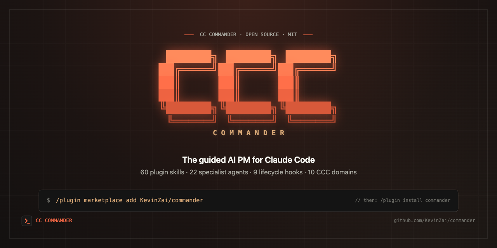

<!-- Keywords: Claude Code plugin, Claude Desktop, Cowork Desktop, AI PM, AI agents, MCP server, Anthropic, Claude Agent SDK, Codex CLI, Claude Mods, plugin workflows, plugin evals, AI coding agent, Claude plugin, skill catalog -->
<p align="center">
  
</p>

# CC Commander — AI PM for Claude Code · 84 Skills · 22 Agents · Core Free Forever

> **Ship faster with Claude Code, Cowork Desktop and Codex.** One plugin install activates 84 skills, 22 specialist AI agents, 30 lifecycle hooks, a HUD mod, six distributable workflows and eight plugin evals across Claude Code Desktop, the Claude Code CLI, the Codex CLI, Cursor, Windsurf and every MCP-capable IDE.

**Install in one step (Claude Code 2.1.292+):**

```
/plugin install commander --marketplace KevinZai/commander
```

**What you get:** 84 click-first `/ccc-*` plugin skills · 22 specialist sub-agents (architect, reviewer, debugger, designer and more) · 30 lifecycle hooks × 51 handlers · the Commander HUD mod · 6 plugin workflows · 8 plugin evals · 2 bundled MCP servers + 16 opt-in · 467 ecosystem skills across 11 CCC domains · 20 vendor packages · Core free forever.


> **Primary surface: Claude Code Desktop (aka Cowork Desktop).** All 84 plugin skills, 22 agents, 30 lifecycle hooks (51 handlers) and 2 credential-free bundled MCP servers (+16 opt-in via `/ccc-connect`) appear inside every session automatically — no terminal needed. Cowork Desktop and Claude Code Desktop are the same app in two UI modes; the plugin works identically in both.

[](https://github.com/KevinZai/commander/stargazers) [](https://opensource.org/licenses/MIT) [](https://twitter.com/kzic) [](./SKILLS-INDEX.md) [](./commander/cowork-plugin/README.md) [](#-one-plugin-every-agent) [](./CHANGELOG.md)

<p>
  <strong>Powered by:</strong>
  <a href="https://anthropic.com/?utm_source=ccc&utm_medium=readme&utm_campaign=powered-by"></a>
  <a href="https://supabase.com/?utm_source=ccc&utm_medium=readme&utm_campaign=powered-by"></a>
  <a href="https://vercel.com/?utm_source=ccc&utm_medium=readme&utm_campaign=powered-by"></a>
  <a href="https://fly.io/?utm_source=ccc&utm_medium=readme&utm_campaign=powered-by"></a>
  <a href="https://upstash.com/?utm_source=ccc&utm_medium=readme&utm_campaign=powered-by"></a>
  <a href="https://cloudflare.com/?utm_source=ccc&utm_medium=readme&utm_campaign=powered-by"></a>
  <a href="https://posthog.com/?utm_source=ccc&utm_medium=readme&utm_campaign=powered-by"></a>
  <em>· <a href="https://docs.commanderplugin.com/affiliate-disclosure">affiliate disclosure</a></em>
</p>

**[Kevin Zicherman](https://kevinz.ai)** · **[@kzic](https://x.com/kzic)** · Built from 200+ community sources · Aggregates 20 vendor packages

**[What's new](#-whats-new-in-800)** · **[Install](#-install)** · **[The 84 skills](#the-84-plugin-skills)** · **[Codex](#-codex-cli)** · **[Browse Skills](SKILLS-INDEX.md)** · **[BIBLE](BIBLE.md)** · **[Cheatsheet](CHEATSHEET.md)** · **[Changelog](CHANGELOG.md)**

### 🎯 Who it's for

| If you are... | CC Commander is... |
|--------------|-------------------|
| 👋 **New to AI coding agents** → using **Claude Cowork Desktop** | Your onboarding buddy — `/ccc` pops up a native chip picker: **Build · Review · Ship · More**. Click. No typing, zero config. |
| 💻 **A developer** → using **Claude Code Desktop** or the **CLI** | Your project manager — spec-first planning, verified multi-agent workflows, knowledge that compounds across sessions. `/ccc-plan` → spec interview → plan file. |
| 🤖 **A Codex user** | The same plugin through the Codex marketplace, plus `/ccc-codex` to manage the Codex CLI from Claude. |
| 🔧 **In Cursor / Windsurf / Cline / Continue** | One hosted MCP endpoint unlocks the 467-skill catalog in your IDE of choice. |

---

## ⭐ Install

### Claude Code Desktop / Cowork Desktop (no terminal)

1. Open **Settings → Plugin Marketplace**
2. Click **Add from GitHub** → enter **`KevinZai/commander`** → **Add**
3. Find **`commander`** in the marketplace → click **Install**
4. Quit and reopen the app (Cmd+Q), type **`/ccc`** — you're live

✅ 84 plugin skills activate. ✅ Zero config. ✅ Zero API keys.

### Claude Code CLI

```bash
/plugin install commander --marketplace KevinZai/commander
```

One step on Claude Code 2.1.292 or later: it adds the `commander-hub` marketplace and installs the plugin. On older builds use the two-step form:

```bash
/plugin marketplace add KevinZai/commander
/plugin install commander
```

### Codex CLI

```bash
codex plugin marketplace add KevinZai/commander
codex plugin add commander@commander-hub
```

Codex treats plugin hooks as untrusted until you review them with `/hooks` inside Codex. See [Codex CLI](#-codex-cli) below.

### Full toolkit + `ccc` binary (optional)

```bash
curl -fsSL https://raw.githubusercontent.com/KevinZai/commander/main/install-remote.sh | bash
```

Installs the `ccc` CLI and the 467-skill ecosystem catalog into `~/.claude/`.

---

## ⬆️ Updating

Third-party marketplaces don't auto-refresh by default, so "I have an old version" is usually a stale local cache, not a missing release.

```bash
claude plugin marketplace update commander-hub && claude plugin update commander
```

Then **fully quit and reopen** Claude Code / Cowork Desktop. The click-first walkthrough is **`/ccc-update`**; the full diagnostic (including stale caches) is **`/ccc-doctor`**, which can also turn on marketplace auto-update for you, with a backup taken first.

More: [Upgrade guide](https://commanderplugin.com/plugin/upgrade) · [Install recovery](https://commanderplugin.com/install-recovery)

---

## 🌐 One plugin, every agent

| Platform | Status | Install |
|---------|--------|---------|
| **Claude Code Desktop / Cowork Desktop** ⭐ | Shipping (primary) | Settings → Plugin Marketplace → Add from GitHub: `KevinZai/commander` |
| **Claude Code CLI** | Shipping | `/plugin install commander --marketplace KevinZai/commander` |
| **Codex CLI and the ChatGPT desktop app** | Shipping (native plugin mirror) | `codex plugin marketplace add KevinZai/commander` |
| **Cursor / Windsurf / Cline / Continue** | Shipping (hosted MCP) | Point the MCP client at `mcp.commanderplugin.com` |

One brand: **Commander**. One repo: `KevinZai/commander`. The plugin name is `commander` everywhere.

---

## 🆕 What's new in 8.0.0

Commander 8 is a full revamp for the October 2026 platform: every prompt rewritten to one standard and adversarially verified file by file, every model reference moved to the Claude 5.5 generation and the GPT-6 family, and the plugin grew a mod, distributable workflows, an eval suite and the hook events Claude Code added since August. Full notes: [CHANGELOG.md](CHANGELOG.md) · [What's new in v8](https://docs.commanderplugin.com/whats-new-v8).

- 🤖 **`/ccc-codex` — manage the Codex CLI from Claude.** Doctor, models, plugins and marketplaces, MCP servers, custom agents (installs the generated TOML agents into `~/.codex/agents/`), Codex Cloud tasks, remote control, `codex review`, `codex update`, `/import` guidance and `config.toml` editing. Every config write asks first, backs the file up and verifies with `codex doctor --json`.
- 📟 **Commander HUD mod.** A band above the prompt shows the Fable Method state, running agents, the session's tool-call budget and an update pill; `/ccc-hud` toggles it without a model turn. Observe-only: no tool approval, no model calls, no network. Needs Claude Code 2.1.287+ (Desktop 2.1.286+); elsewhere Commander runs hooks-only. See [docs/MODS.md](docs/MODS.md).
- 🧩 **Plugin workflows.** Six dynamic workflows ship as `/commander:<name>`: `ccc-audit`, `ccc-deep-review`, `ccc-fleet`, `ccc-migrate` and the new `ccc-prompt-audit` and `ccc-release-audit`.
- 🧪 **Plugin evals.** Eight `claude plugin eval` cases (hub, plan, review, doctor, fable, update, suggest, codex) under `evals/`.
- 🪝 **Seven new hook events** — 30 lifecycle hooks, 51 handlers: PermissionDenied, PreModelSwitch, PostModelSwitch, TeammateIdle, CwdChanged, DirectoryAdded and FileChanged on `CLAUDE.md`. WorktreeCreate and WorktreeRemove are deliberately not registered: a hook there replaces git's own worktree handling.
- 🧠 **Current models by alias.** `fable` (Fable 5.1) deep, `opus` (Opus 5.5) default, `sonnet` (Sonnet 5.5) fast, `haiku` (Haiku 5.5) bulk. Codex routes to GPT-6 Astra, GPT-6.1 Sol, GPT-6 Sol and GPT-6 Luna.
- ✍️ **Every prompt rewritten.** Skills, agents, personas, rules, menus and templates follow the [v8 prompt standard](docs/PROMPT-STANDARD.md): procedure-first, AskUserQuestion pickers, done-when checks, guardrails, no counts or versions in bodies.
- 🗂️ **Artifacts as they are today.** Decks use the current Artifact tool; Mission Control and the Linear board sync rows through the artifact database instead of republishing.
- 📦 **New vendor:** `anthropics/claude-code-playground` (sample mods, Apache-2.0), making 20.

**Earlier releases** — the Commander Console, update self-detection, the Cockpit, Mission Control, the Fable Method and everything before — are in [CHANGELOG.md](CHANGELOG.md).

---

## 🎯 Why CC Commander

Stock Claude Code is a blank terminal with amnesia. Every other plugin solves one slice. CC Commander is a **guided AI PM**: click-first UX, an intelligence layer that recommends the next move, verified multi-agent workflows, and the ecosystem pre-wired. One install, everything active.

| Moat | CC Commander | Cursor / Windsurf / Copilot | OSS (Cline / Continue / Aider) |
|------|--------------|----------------------------|-------------------------------|
| **Lifecycle hooks (30 × 51 handlers)** | ✅ Session, prompt, tool, permission, model-switch, compaction, subagent and task events | ❌ None | ❌ None |
| **22 specialist agent personas** | ✅ Architect, security-auditor, language reviewers, designer, debugger… | ❌ None ship pre-built | ❌ None ship pre-built |
| **Verified workflows** | ✅ Six plugin workflows; every finding refuted or confirmed by a fresh agent | ❌ | ❌ |
| **18 MCP servers (2 bundled + 16 opt-in)** | ✅ Zero-config bundle; Linear, Supabase, Vercel, Notion, Slack, Sentry, Stripe, Cloudflare… opt-in | ⚠️ Manual setup | ⚠️ Manual setup |
| **Spec-first planning** | ✅ `/ccc-plan` → interview → plan file with evals | ❌ | ❌ |
| **Cross-runtime** | ✅ Claude Code + Codex + hosted MCP | ❌ IDE-locked | ⚠️ IDE-locked |
| **Pricing** | ✅ Core free forever — no signup, no card, no gates | ⚠️ Tiered | ✅ BYOK free |

- 🖱️ **Click-first UX** — every menu is a native `AskUserQuestion` chip picker. No numbered menus, no ASCII prompts.
- 🧠 **`/ccc-suggest`** — reads project state (stack, branch, recent commits, open todos, recent errors) and returns **one starred next step** with reasoning, naming another plugin when it fits better.
- 🧭 **Orchestrator / executor** — `/ccc-orchestrate` has Fable or Opus write a goal file, then Codex (GPT-6 Astra, GPT-6.1 Sol or GPT-6 Luna), Codex Cloud or a Sonnet subagent executes it, and the orchestrator verifies the acceptance criteria. *Pay for Fable on the thinking, not the typing.*
- 🎭 **22 specialist agents with persona voices** — architect, security-auditor, performance-engineer, content-strategist, data-analyst, designer, product-manager, technical-writer, devops-engineer, qa-engineer, reviewer, builder, researcher, debugger, fleet-worker, and typescript / python / go / rust / java / kotlin / csharp reviewers.
- 🎛️ **Commander Console** — `/ccc-console` opens one inline console (Overview · Usage · Safety · Memory · History · Launch) with a prompt bar into the live session.
- 🚁 **Fleet orchestration** — `/ccc-fleet` runs agents in parallel git worktrees: fan-out, pipeline, judge panel, debate.
- 🗺️ **`/ccc-cheatsheet`** — reads the installed plugin from disk and renders a live Mermaid map. Never drifts.
- 🔄 **Weekly vendor sync** — 20 vendor submodules stay current via GitHub Actions.

### 🧠 The Fable Method

**The operating doctrine distilled from Anthropic's frontier Fable model, encoded as 12 enforceable gates** — so any model running Commander produces Fable-shaped results. Arm it with `/ccc-fable on`, self-check with `/ccc-fable audit`. Full doctrine: [`rules/fable-method.md`](commander/cowork-plugin/rules/fable-method.md).

- **Never trust a single pass** — the agent that does the work never grades it.
- **Loops need verifiers, state and stops** — otherwise it is an agent agreeing with itself on repeat.
- **Prove it before you alarm** — a scary number is a hypothesis until the exact check runs.
- **Context is disposable, state is durable** — handoffs, memory and the tracker hold the record, not the chat.

---

## 🏗️ Built on Claude Agent SDK primitives

Commander is a thin PM layer over primitives Claude Code already ships. The **brain/hands** pattern keeps orchestration (planning, routing, deciding) in the main session and execution in 22 specialist sub-agent personas.

| Primitive | How Commander uses it |
|---|---|
| **Skills** | 84 `/ccc-*` skills with `model` and `effort` frontmatter; long tables live in `references/` |
| **Subagents + Agent `effort`** | 22 agents on aliases (`fable` for architect and security-auditor, `opus` by default, `sonnet` for writers and fleet workers); skills pass an effort level per dispatch |
| **Workflow tool** | Six plugin workflows run as `/commander:<name>`; `/effort ultracode` turns any substantial task into a planned workflow |
| **Hooks** | 30 lifecycle hooks with 51 handlers, shell-form and mirrored to Codex |
| **Mods** | The Commander HUD band and `/ccc-hud` command |
| **Plugin evals** | Eight `claude plugin eval` cases guard the core skills' behavior |
| **Routines and `/loop`** | `/ccc-loop`, `/ccc-ci` and `/ccc-nightwatch` schedule follow-ups instead of busy-waiting |
| **Artifact tool** | Console, decks, Mission Control and the Linear board publish private pages; shared rows go through the artifact database |
| **MCP** | 2 bundled servers plus 16 opt-in connectors via `/ccc-connect` |

### Model routing

| Tier | Claude alias | Codex model | Use |
|---|---|---|---|
| Deep | `fable` (Fable 5.1) | `gpt-6-astra` | architecture, migrations, threat models, verifying load-bearing claims |
| Default | `opus` (Opus 5.5) | `gpt-6.1-sol` | implementation, review, orchestration |
| Fast | `sonnet` (Sonnet 5.5) | `gpt-6-sol` | bounded edits, docs, routers, focused reviews |
| Bulk | `haiku` (Haiku 5.5) | `gpt-6-luna` | classification, routing, extraction, hook-side summaries |

---

## 🤖 Codex CLI

Commander ships a generated Codex mirror (`commander/cowork-plugin-codex/`, built by `npm run build:codex`) with the same skills, the 22 agents as Codex TOML subagents, and hooks translated to 11 of Codex's 12 events (Interrupt has no Claude source).

- **Install:** `codex plugin marketplace add KevinZai/commander`, then `codex plugin add commander@commander-hub`.
- **Models:** GPT-6 Astra (`gpt-6-astra`, deep and verification), GPT-6.1 Sol (`gpt-6.1-sol`, the default executor), GPT-6 Sol (`gpt-6-sol`, bounded implementation) and GPT-6 Luna (`gpt-6-luna`, mechanical and bulk work).
- **`/ccc-codex`** manages the Codex CLI from inside Claude: `doctor`, model selection, plugins and marketplaces, MCP servers, installing Commander's agents into `~/.codex/agents/`, Codex Cloud tasks, remote control, `codex review`, `codex update` and `config.toml` edits — each write confirmed, backed up and verified.
- **`/ccc-orchestrate`** hands a goal file to `codex exec --json --output-last-message` and verifies the result back in Claude.

---

## ⚡ Plugin workflows and ultracode

Dynamic workflows are scripts the Workflow tool runs in the background, spawning many agents whose findings are cross-checked before they reach you. Commander ships six, each runnable directly:

| Workflow | Run it | What it does |
|----------|--------|-------------|
| `ccc-audit` | `/commander:ccc-audit` · `/ccc-xray` | Repo health audit — one finder per dimension, every finding verified, scored scorecard |
| `ccc-deep-review` | `/commander:ccc-deep-review` · `/ccc-review` | Branch review over four weighted dimensions, severity-grouped verdict |
| `ccc-migrate` | `/commander:ccc-migrate` | Discover every site, transform each in its own worktree, verify each change with an independent skeptic |
| `ccc-fleet` | `/commander:ccc-fleet` · `/ccc-fleet` | Fan-out, pipeline, judge panel or multi-lens debate |
| `ccc-prompt-audit` | `/commander:ccc-prompt-audit` | Checks every skill and agent against the prompt standard |
| `ccc-release-audit` | `/commander:ccc-release-audit` | Runs every release gate and returns go or no-go with blockers |

**Ultracode** is its own toggle: `/effort ultracode on` makes Claude plan a verified workflow for each substantial task; it does not change the reasoning level. `/ccc-ultracode` explains both dials and launches a bundled workflow. For one task, include the word `workflow` in the prompt.

---

## The 84 plugin skills

Every skill opens with a native chip picker. Generated from each skill's frontmatter by `node scripts/render-skill-table.js --write README.md`; `inherit` means the session's model.

<!-- skill-table:start -->
| Skill | What it does | Model |
|---|---|---|
| `/ccc` | Commander's click-first home: reads the project context, then routes to build, review, ship or the More menu (plan, x-ray, Codex CLI, fleet, connectors,… | `sonnet` |
| `/ccc-adhd` | Answer-first output: the fix, then command, then file:line, context last. | `haiku` |
| `/ccc-adopt` | Merge Commander's orchestrator/executor section and a stack-tailored skill and agent list into an existing project's CLAUDE.md as a delimited, re-runnable… | `sonnet` |
| `/ccc-agent-writing` | Draft a spec, PRD, PR description, README section, runbook or technical doc that a reader can act on without a follow-up question: named reader, answer first,… | `sonnet` |
| `/ccc-brainstorm` | Design-first ideation gate: three parallel agents propose a simple, a scalable and a user-delight approach, rendered as a tradeoff matrix, then you pick a… | `sonnet` |
| `/ccc-broadcast` | Relay build, deploy, CI, task and cost outcomes as short scrubbed summaries to a connected team chat or email, so non-developers see what shipped. | `sonnet` |
| `/ccc-browse` | Browse every CC Commander skill, agent and domain: publish the searchable Cockpit catalog page after consent, or drill in four at a time with pickers and… | `sonnet` |
| `/ccc-build` | Scaffold a new web app, API or CLI from a three-question spec interview, built by a background agent and verified before it is called ready. | `inherit` |
| `/ccc-changelog` | Summarize what changed in the latest CC Commander release, or a named version, from CHANGELOG.md in a short scan-friendly digest. | `sonnet` |
| `/ccc-cheatsheet` | Live map of Commander: reads the installed plugin's skills, workflows, menus, agents, hooks and MCP servers from disk and renders a Mermaid flow plus a… | `sonnet` |
| `/ccc-ci` | Diagnose CI and deploy failures: pull the failing run's log, classify the cause, propose a fix, and follow runs with /loop or a Routine; optional… | `sonnet` |
| `/ccc-claudemd` | Audit a project CLAUDE.md against the real codebase for stale paths, dead commands, missing context and token waste, then apply fixes only after picker… | `sonnet` |
| `/ccc-code-review` | Alias for /ccc-review: forwards a code, PR or diff review request with its arguments to the canonical review workflow. | `haiku` |
| `/ccc-codex` | Manage the OpenAI Codex CLI: doctor, models, plugins, MCP servers, custom agents, cloud tasks, remote control, reviews, updates, import and config, backing up… | `sonnet` |
| `/ccc-connect` | Opt-in connector wizard with affiliate disclosure: pick a service (Supabase, Linear, Vercel, Sentry, Notion, Slack, Stripe, research tools and more) and wire… | `sonnet` |
| `/ccc-console` | Open the Commander Console inline (agents, usage, safety, memory, history, launch chips, prompt bar) or publish one tab as a private snapshot page after… | `sonnet` |
| `/ccc-content` | Draft blog posts, social threads, email campaigns, landing-page copy and docs in three questions, with an optional brief, review and scheduling pipeline. | `inherit` |
| `/ccc-data` | Route data work to the right method: ETL/ELT pipelines, SQL optimization, charts and dashboards, machine learning, data quality, product analytics, scheduled… | `inherit` |
| `/ccc-debate` | Adversarial multi-agent debate: lens agents (security, performance, architecture, product, contrarian) argue and cross-examine one design, plan or diff, then… | `sonnet` |
| `/ccc-deploy` | Deploy the current build to Vercel, Fly.io, Cloudflare, GitHub Pages, npm, or a package deploy script, verify the live URL, and draft post-deploy notes. | `sonnet` |
| `/ccc-deploy-check` | Pre-deploy readiness gate: tests, build, debug logs, secrets, TODOs, lockfile and destructive-migration checks with a GO, CAUTION or NO-GO verdict, plus risk… | `sonnet` |
| `/ccc-design` | Route design work to the right method: landing page, component system, Impeccable polish pass, Figma to code, chat UI, Design.md capture or screenshot to… | `inherit` |
| `/ccc-devops` | DevOps domain router: picks the right specialist for CI/CD pipelines, zero-downtime deploys, Docker and container security, AWS, Terraform, Prometheus/Grafana… | `sonnet` |
| `/ccc-doc-sync` | Sync skill, agent and hook-handler counts and the version string across Commander docs from contract.json and package.json, with a --check drift gate for CI. | `sonnet` |
| `/ccc-doctor` | Paste-ready Commander health report: install mode, installed vs latest version, clone and cache state, settings, MCP servers, plugin validate and details,… | `sonnet` |
| `/ccc-domains` | Alias for /ccc-learn: opens the domain picker to browse and load a skill domain such as design, marketing, SaaS, testing, DevOps or security. | `sonnet` |
| `/ccc-e2e` | Pre-release assessment that fans out via /ccc-fleet into up to three isolated workers (QA audit, unit tests, Playwright E2E) running /ccc-testing lanes, then… | `sonnet` |
| `/ccc-ecc` | Selective ECC loader: pick one Everything Claude Code skill, agent or hook from the vendored checkout and symlink or copy only that component into ~/.claude,… | `sonnet` |
| `/ccc-fable` | Arm, check, audit or disarm the Fable Method: the PM loop, 12 checkable gates, workflow-first posture and verifier separation, persisted in Commander state. | `sonnet` |
| `/ccc-fleet` | Run parallel agents on one task: fan-out slices in isolated worktrees, a sequential pipeline, a review panel, a background run, or a director-lead-specialist… | `inherit` |
| `/ccc-fleet-viz` | Show a /ccc-fleet run as a live tree of workers (done, running, failed, waiting) with branches and a Mermaid diagram, refreshing until every worker finishes. | `sonnet` |
| `/ccc-handoff` | Write a dense handoff file and tell the user to resume in a new chat before a long context degrades output quality. | `sonnet` |
| `/ccc-harden` | Pre-launch production hardening audit across hosting, GitHub, error tracking, analytics, payments, secrets/PII headers and Cloudflare. | `sonnet` |
| `/ccc-hermes` | Optional bridge between Claude Code and a local Hermes agent gateway: chat channels can wake a Claude Code session, and Claude Code can post progress or… | `sonnet` |
| `/ccc-infra` | Dev services status: probes the local services you declare in an optional services.json, plus Claude MCP connections and Codex CLI health, and recommends the… | `haiku` |
| `/ccc-knowledge` | Search, browse and add lessons in the local CC Commander knowledge base: recent lessons, topic search, category view, stats and file-edit captures. | `haiku` |
| `/ccc-learn` | Pick a CC Commander skill domain in one click (design, marketing, SaaS, DevOps, SEO, testing, security, data and more) and hand off to that domain's router… | `sonnet` |
| `/ccc-linear` | View your open Linear issues, pick one to work on (moves it to In Progress and creates a branch), create a new issue, or see a board overview, all from pickers. | `sonnet` |
| `/ccc-linear-board` | Publish a team's Linear issues as a private Kanban page whose cards update in place from a shared data store, or hand off to /ccc-linear to view, pick or… | `sonnet` |
| `/ccc-loop` | Pick the right loop primitive (turn, /goal, /loop interval or self-paced, ScheduleWakeup, Routines via /schedule), gate it, give it an independent verifier… | `sonnet` |
| `/ccc-makeover` | Score project health with /ccc-xray, apply the top recommendations one at a time with your OK, and show a before/after report card. | `inherit` |
| `/ccc-marketing` | Route marketing work to the right specialist method: brand context, content, conversion optimization, email and ads, growth experiments, competitor… | `sonnet` |
| `/ccc-memory` | Keep durable project memory in two tiers: CLAUDE.md for always-loaded facts and a memory/ directory of dated notes, decisions, gotchas and preferences loaded… | `sonnet` |
| `/ccc-mission-control` | Agent mission control: who is working on what, as a local live dashboard, a plain-English status, suggestion triage, or a private snapshot page whose task… | `sonnet` |
| `/ccc-mobile` | Route mobile work to the right method: React Native/Expo, Flutter, SwiftUI or Jetpack Compose builds, mobile testing, app store optimization, push… | `inherit` |
| `/ccc-more` | Commander's second-page menu: plan, x-ray, Codex CLI management, fleet, Linear, connectors, tune-up, catalog browse and the plugin audit workflows, one click… | `sonnet` |
| `/ccc-night-mode` | Spec-first autonomous build that runs overnight or immediately in multi-cycle build and independent-review loops, checkpointing status each cycle and stopping… | `opus` |
| `/ccc-nightwatch` | Remote permission relay for unattended runs: risk-classify each tool call, auto-allow reads, send risky calls to your phone via Telegram or Discord for a tap,… | `sonnet` |
| `/ccc-onboard` | Contributor first-hour plan for the current repository: reads CLAUDE.md, BIBLE.md and package.json, checks required tools, asks the contributor's role, and… | `sonnet` |
| `/ccc-orchestrate` | Write a goal file, run it on a separate executor (Codex GPT-6 or a Sonnet subagent) in an isolated worktree, then verify every acceptance criterion. | `inherit` |
| `/ccc-plan` | Turn an idea, bug, refactor or Linear issue into a reviewed plan file with evals, via a short spec interview and a background planner agent that writes to the… | `sonnet` |
| `/ccc-plan-exec` | Plan cheap, execute capable: a fast model drafts the loop (steps, per-step body, verify condition), a capable model runs each step in an isolated worktree… | `sonnet` |
| `/ccc-prompt-fix` | Diagnose a prompt against the six prompt-quality patterns and return a tighter rewrite with the reason for each change, a 0-6 score, or the best matching… | `sonnet` |
| `/ccc-qa` | QA pass before shipping: detects the framework, runs unit, integration and E2E suites, computes the coverage delta, audits flaky tests and has qa-engineer… | `sonnet` |
| `/ccc-recall` | Search past saved sessions and curated memory notes for an earlier fix, decision or file, and answer with the source file and date cited. | `sonnet` |
| `/ccc-relay` | Chain independent loop sessions (spec, build, review, then a human-gated merge) that hand off through a durable state file, tracker status or reaction, each… | `sonnet` |
| `/ccc-research` | Research before you build: cited multi-source research, spec interviews, cross-model review, literature reviews, competitive and trend analysis, and… | `inherit` |
| `/ccc-resume-session` | Load a saved session file from ~/.claude/sessions/ (latest, by date, or by path), read it fully, and brief project, state, what not to retry, blockers and… | `sonnet` |
| `/ccc-review` | Audit the current branch, security posture, performance hot paths or the whole project; routes to /commander:ccc-deep-review, built-in /code-review or a… | `opus` |
| `/ccc-rollback` | Roll production back by picking a known-good commit or tag, creating atomic git revert commits, pushing them, redeploying through the /ccc-deploy runners, and… | `sonnet` |
| `/ccc-saas` | Route SaaS work to the right method: scaffold, auth, database, API, frontend, Stripe billing, webhooks, multi-tenancy, feature flags, metrics and conversion. | `inherit` |
| `/ccc-safety` | Safety deck: dangerous actions Commander's hooks blocked, auto-fixes applied, and the tools that fail most, narrated here or published as a private snapshot… | `sonnet` |
| `/ccc-save-session` | Compress the current session into a dense reloadable file in ~/.claude/sessions/: decisions, files touched, what worked, what failed and why, open questions,… | `sonnet` |
| `/ccc-security` | Application security hub: built-in /security-review plus lanes for OWASP Top 10, secrets, dependency CVEs, prompt-injection defense, CodeQL CI, variant… | `opus` |
| `/ccc-seo` | Route SEO work to the right method: technical audit and fixes, AI search optimization (AEO, GEO, LLMO), content clusters and briefs, analytics, programmatic… | `sonnet` |
| `/ccc-session` | Alias that routes session work to the canonical skills: save the current session with /ccc-save-session, or reload a saved one with /ccc-resume-session. | `haiku` |
| `/ccc-settings` | Settings hub: Commander preferences (name, level, cost ceiling, theme, animations, launch mode, Linear, reset) plus Claude Code permission mode, effort, model… | `sonnet` |
| `/ccc-ship` | Ship menu: run a parallel pre-flight matrix with a GO, CAUTION or NO-GO scorecard, cut a tagged release with changelog, deploy to a platform, or roll back the… | `sonnet` |
| `/ccc-smb-ops` | Small-business back office from a bank CSV or a typed list: 13-week cash-flow forecast, invoicing and AR chasing, payroll planning, CRM cleanup, expense… | `inherit` |
| `/ccc-spawn` | Spin self-contained work off on demand: a background subagent, a separate session (Cowork spawn_task chip or CLI /spawn peer), or an independent expert pass;… | `sonnet` |
| `/ccc-standup` | Write a yesterday / today / blockers standup from your commits, PRs, tracker issues and Commander session notes, or from rough notes you type. | `sonnet` |
| `/ccc-start` | First-run Commander onboarding: detects the setup live, offers new-project, import, tour or skip pickers, writes a start plan file and marks onboarding… | `sonnet` |
| `/ccc-suggest` | Reads project state and recent activity, then recommends one next /ccc-* workflow, skill or plugin with named reasons and picker alternatives; also runs as a… | `opus` |
| `/ccc-systematic-debugging` | Root-cause debugging under one law: no fix without a confirmed root cause. | `opus` |
| `/ccc-tasks` | Track work in one markdown file, tasks/todo.md, with checkboxes, P0-P3 priorities and status marks; no database, service or sync. | `sonnet` |
| `/ccc-testing` | Testing domain router: picks the lane for TDD, E2E, visual regression, load testing, QA, regression checks, evals or verification and runs test-writing work… | `sonnet` |
| `/ccc-triage` | Triage a GitHub repo's open issues and PRs with the gh CLI: flag stale, unlabeled and CI-failing items, propose labels and next actions, apply labels one… | `sonnet` |
| `/ccc-tuneup` | Audit and safely optimize the local Commander setup: version freshness, junk, count drift, superseded agents, hooks, settings keys, MCP staleness and cost… | `sonnet` |
| `/ccc-ultracode` | Run deep, multi-agent work as adversarially verified workflows: repo audits, branch reviews, migrations, fleets. | `inherit` |
| `/ccc-update` | Update the installed CC Commander plugin: detect the install mode and installed vs latest version, hand over the exact update commands, then verify the… | `sonnet` |
| `/ccc-upgrade` | Maintainer-only vendor submodule updater: audits every submodule under vendor/ against upstream, shows commits and files behind, then updates the picked ones… | `sonnet` |
| `/ccc-usage` | Usage and cost deck: estimated savings from routing to cheaper models, cost per day and cost by app, narrated here or published as a private snapshot page… | `sonnet` |
| `/ccc-xray` | Project health scorecard: scans the current repo for quality, docs, tests, deps, security, performance, CI, session cost and plugin context cost, then returns… | `sonnet` |
| `/ccc-yolo-setup` | Cut approval prompts safely: keep auto permission mode, add a vetted read-only allowlist plus secret deny rules, back up settings, and set bypassPermissions… | `sonnet` |
<!-- skill-table:end -->

The 11 CCC domain routers (`ccc-design`, `ccc-marketing`, `ccc-saas`, `ccc-devops`, `ccc-seo`, `ccc-testing`, `ccc-security`, `ccc-data`, `ccc-research`, `ccc-mobile`, `ccc-makeover`) and the `ccc-smb-ops` operations router load sub-skills on demand. See [SKILLS-INDEX.md](SKILLS-INDEX.md) for the full catalog.

---

## 🪝 Lifecycle hooks

30 lifecycle hooks × 51 handlers, registered in [`hooks/hooks.json`](commander/cowork-plugin/hooks/hooks.json):

| Group | Events |
|---|---|
| Session | SessionStart, Setup, SessionEnd, InstructionsLoaded, ConfigChange, CwdChanged, DirectoryAdded, FileChanged |
| Prompt | UserPromptSubmit, UserPromptExpansion |
| Tools and permissions | PreToolUse, PostToolUse, PostToolUseFailure, PostToolBatch, PermissionRequest, PermissionDenied |
| Model | PreModelSwitch, PostModelSwitch |
| Agents and tasks | SubagentStart, SubagentStop, TaskCreated, TaskCompleted, TeammateIdle |
| Turn and context | Stop, StopFailure, Notification, PreCompact, PostCompact, Elicitation, ElicitationResult |

Handlers guard secrets and protected config, enforce cost ceilings, capture knowledge, feed Mission Control, nudge on stale `CLAUDE.md` files and recover context after compaction. The Codex mirror wires 11 of Codex's 12 events (Interrupt has no Claude source).

---

## 🔌 MCP servers

**2 credential-free bundled MCP servers** — `context7` (library docs) and `sequential-thinking`. **16 opt-in MCP servers** via `/ccc-connect`: Linear, Supabase, Vercel, Neon, Fly.io, Upstash, Notion, Slack, Discord, Sentry, Stripe, Browserbase, Postgres, Cloudflare, Resend and AgentMail. The wizard also wires GitHub, Figma, Tavily, Exa, Firecrawl, Playwright and other category options. See [CONNECTORS.md](commander/cowork-plugin/CONNECTORS.md) and [MCP.md](commander/cowork-plugin/MCP.md).

---

## 11 CCC Domains

Each domain is a router that dispatches to specialized sub-skills on demand.

| Domain | What's inside |
|--------|---------------|
| **ccc-design** | landing pages, UI audit, animation, responsive layout, design tokens, accessibility, named-look design systems, video/HTML design capture |
| **ccc-marketing** | CRO, email campaigns, ad copy, social, SEO content, A/B testing, funnels, brand voice, case studies |
| **ccc-saas** | auth, billing, API design, schema, multi-tenancy, onboarding, admin dashboards, webhooks, feature flags |
| **ccc-devops** | GitHub Actions, Docker, cloud deploys, Terraform, monitoring, CI/CD, Kubernetes, rollbacks |
| **ccc-seo** | meta tags, JSON-LD, sitemaps, Core Web Vitals, internal linking, keyword research, structured data |
| **ccc-testing** | Vitest, Playwright E2E, TDD, API and load testing, coverage, visual regression, accessibility testing |
| **ccc-makeover** | `/ccc-xray` health score, `/ccc-makeover` agent swarm, before/after report card |
| **ccc-data** | SQL optimization, pipelines, analytics, visualization, ML, data quality, vector search |
| **ccc-security** | OWASP top 10, secrets scanning, dependency audit, container security, CSP, auth hardening |
| **ccc-research** | competitive and market research, technology evaluation, trend analysis, synthesis |
| **ccc-mobile** | React Native, Expo, push notifications, deep linking, app store optimization, offline-first |

---


## 20 Vendor Packages

Commander aggregates the best Claude Code tools as git submodules under `vendor/`, refreshed weekly. All 20 vendor packages are permissive open source; each keeps its upstream license.

| Package | What you get |
|---------|-------------|
| [acpx](https://github.com/openclaw/acpx) | ACP protocol CLI for headless, parallel agent-to-agent runs |
| [Caliber](https://github.com/caliber-ai-org/ai-setup) | Config scoring and drift detection |
| [claude-code-best-practice](https://github.com/shanraisshan/claude-code-best-practice) | Reference architecture and best practices |
| [claude-code-playground](https://github.com/anthropics/claude-code-playground) | Anthropic's sample Claude Mods |
| [claude-code-prompts](https://github.com/repowise-dev/claude-code-prompts) | Defensive prompt patterns, verification specialist |
| [claude-code-ultimate-guide](https://github.com/FlorianBruniaux/claude-code-ultimate-guide) | Templates, quizzes and a threat database |
| [Claude HUD](https://github.com/jarrodwatts/claude-hud) | Real-time status display, offline cost tracking, git diffs |
| [claude-reflect](https://github.com/BayramAnnakov/claude-reflect) | Self-improving skills with reflection loops |
| [claude-skills](https://github.com/alirezarezvani/claude-skills) | A large skill and agent library with prompt A/B testing |
| [Compound Engineering](https://github.com/EveryInc/compound-engineering-plugin) | Knowledge compounding, mandatory code review |
| [Everything Claude Code](https://github.com/affaan-m/everything-claude-code) | The full harness — skills, commands, agents, hooks |
| [graphify](https://github.com/safishamsi/graphify) | Any input → clustered knowledge graph, HTML + JSON |
| [gstack](https://github.com/garrytan/gstack) | CEO/eng plan review, office hours, QA gates |
| [Matt Pocock skills](https://github.com/mattpocock/skills) | Focused TypeScript and engineering skills |
| [MengTo/Skills](https://github.com/MengTo/Skills) | Named-look design systems, video/HTML → prompt capture |
| [oh-my-claudecode](https://github.com/Yeachan-Heo/oh-my-claudecode) | HUD with worktree support, quota tracking |
| [repomix](https://github.com/yamadashy/repomix) | Pack a codebase for AI with tree-sitter compression |
| [RTK](https://github.com/rtk-ai/rtk) | CLI output filtering for token savings |
| [Superpowers](https://github.com/obra/superpowers) | Structured thinking: brainstorm, plan, TDD, verify |
| [UI/UX Pro Max](https://github.com/nextlevelbuilder/ui-ux-pro-max-skill) | Design intelligence for professional UI across platforms |

`claude-mem` stays an external opt-in (AGPL) — Commander reads it when installed and never bundles it.

### 🤝 Works with other plugins

`/ccc-suggest` doesn't hoard — when another plugin is the right tool, it names it: **claude-mem** for cross-session recall, **superpowers** for structured thinking, **caveman** for token-heavy loops, **impeccable** for UI polish, **graphify** for knowledge graphs, **ECC** for the full harness, **gstack** for plan reviews. Install any separately and Commander routes to it.

**Commander on top of ECC:** ECC is the comprehensive harness; Commander is the PM/orchestration layer — click-first chips, `/ccc-suggest` routing, verified workflows, the brain/hands pattern. `/ccc-ecc` loads one ECC skill, agent or hook without the full harness.

---

## 🆚 Compare

| | CC Commander | ECC | Superpowers | gstack |
|---|---|---|---|---|
| **Primary surface** | Claude Code Desktop plugin + CLI + Codex | CLI harness | Claude Code CLI | Claude Code CLI |
| **Click-first UX** | ✅ Native chip pickers | ❌ Text menus | ❌ Slash commands | ❌ Slash commands |
| **Sub-agent personas** | 22 (architect, reviewer, debugger…) | many | 0 | a few |
| **Skill count** | 551 (84 plugin + 467 ecosystem) | large | small | small |
| **Verified workflows + evals** | ✅ 6 workflows, 8 evals | ❌ | ❌ | ❌ |
| **Cross-runtime** | ✅ Claude Code, Codex, hosted MCP | ❌ Claude only | ❌ Claude only | ❌ Claude only |
| **Free** | ✅ Core forever | ✅ | ✅ | ✅ |
| **Recommends rivals** | ✅ `/ccc-suggest` names other plugins | ❌ | ❌ | ❌ |

**vs aider:** aider is a pair programmer — diff-based edits, any LLM, deep Git. Commander is a PM — plans, routes, dispatches specialists and verifies. Use aider for solo rapid edits, Commander for multi-phase features. [Full comparison](https://docs.commanderplugin.com/compare/vs-aider).

---

## 2-Minute First Win

```
# 1. Open the command center
/ccc

# 2. Say: "build me a REST API with TypeScript"
# → Commander asks 3 clarifying questions, then a background agent builds and verifies it

# 3. Say: "review my branch"
# → /commander:ccc-deep-review runs; every finding is confirmed or refuted before you see it

# 4. Arm the doctrine for a long task
/ccc-fable on
```

---

## Intelligence Layer

Before dispatching, Commander scores the task, reads your stack, pulls relevant lessons from past sessions and picks a model tier and budget.

1. **Complexity scoring** (`dispatcher.js`) — every task scored 0–100 from keyword signals, word count and file scope; routine edits go to `haiku` or `sonnet`, multi-phase builds to `opus`, the hardest reasoning to `fable`.
2. **Stack detection** (`project-importer.js`) — reads `package.json`, `Dockerfile`, `go.mod`, `requirements.txt`, the branch and recent commits; detects monorepos.
3. **Skill recommendations** (`skill-browser.js`) — stack match, keyword match and your usage history rank the catalog.
4. **Knowledge compounding** (`knowledge.js`) — each session stores a lesson under `~/.claude/commander/`, searched before the next dispatch with time-decay relevance.

Smart retry handles rate limits (wait and retry), context overflow (reduce turns and retry) and budget overruns (clear error with next steps).

---

## CLI reference (optional `ccc` binary)

| Command | What it does |
|---------|-------------|
| `ccc` | Interactive mode (tmux tabbed) |
| `ccc --stats` | Sessions, streaks, level, cost |
| `ccc --test` | Self-test (verify install) |
| `ccc --update` | Pull latest + reinstall |
| `ccc --repair` | Reset corrupt state |
| `ccc --simple` | Menu-only, no tmux |
| `ccc --dispatch "task" --json` | Headless dispatch for AI orchestrators |
| `ccc --list-skills --json` | The 467-skill catalog as JSON |
| `ccc --daemon` / `ccc --queue "task"` | Background agent with a task queue |

Override flags: `--model opus` · `--max-turns 50` · `--budget 5` · `--cwd /path`. Files live in `~/.cc-commander/` (source) and `~/.claude/` (skills, commands, hooks).

---

## Security

- **No command injection** — shell calls use `execFileSync` with array arguments.
- **Auto permission mode by default** — dispatches use `--permission-mode auto`; only the opt-in night mode skips permissions, and says so.
- **Guard hooks** — secret-leak guard, config protection and permission gate run on every relevant tool call; denials are logged for `/ccc-safety`.
- **Observe-only HUD** — the mod registers no tool, permission or prompt hooks and makes no network calls.
- **PII scanning in CI** and zero known npm vulnerabilities at release.

Report issues via [SECURITY.md](SECURITY.md).

---

## The Kevin Z Method

> 7 rules from 200+ articles and production use.

1. Plan before coding
2. Context is milk — keep it fresh
3. Verify, don't trust
4. Subagents = fresh context
5. CLAUDE.md is an investment
6. Boring solutions win
7. Operationalize every fix

Full methodology: **[BIBLE.md](BIBLE.md)** · quick reference: **[CHEATSHEET.md](CHEATSHEET.md)** · printable cheat sheets in [`docs/cheatsheets/`](docs/cheatsheets/).

---

## Core Free Forever

All 84 plugin skills, 22 specialist agents, 30 lifecycle hooks, 2 bundled MCP servers and 16 opt-in connectors — free forever, no credit card, no feature gating. Sustained by transparent affiliate links, consulting, an optional Pro community and GitHub Sponsors. A hosted-infrastructure Pro tier is planned later; all content stays free.

---

## Who Built This

CC Commander is built by [Kevin Z](https://kevinz.ai) ([@kzic](https://x.com/kzic)) — a non-technical entrepreneur and CEO of [MyWiFi Networks](https://mywifinetworks.com) (20+ years in tech, never wrote production code). He scanned 200+ Claude Code articles, plugins and skills and distilled them into one self-learning AI project manager. Every feature was built with Claude Code itself.

---

## Share

[](https://twitter.com/intent/tweet?text=CC%20Commander%20%E2%80%94%2084%20skills%2C%2022%20agents%2C%2030%20hook%20events.%20The%20guided%20AI%20PM%20for%20Claude%20Code%20and%20Codex.%20Core%20free%20forever.&url=https%3A%2F%2Fgithub.com%2FKevinZai%2Fcommander&via=commanderplugin)

## License

MIT for the full project. The Intelligence Layer (4 files) carries an additional [Commons Clause](docs/LICENSE-INTELLIGENCE.md) — free to use, not to sell. All 20 vendor packages are permissive open source (MIT, Apache-2.0 and CC-BY-SA-4.0); each keeps its upstream license.

## Contributing

See [CONTRIBUTING.md](CONTRIBUTING.md). Plugin skills live in `commander/cowork-plugin/skills/<name>/SKILL.md` and follow [docs/PROMPT-STANDARD.md](docs/PROMPT-STANDARD.md); after adding one, re-render the table above with `node scripts/render-skill-table.js --write README.md`.

---

<div align="center">

**CC Commander v8.1.1** · **[Kevin Zicherman](https://kevinz.ai)** · **[@kzic](https://x.com/kzic)**

*Every Claude Code tool. One install. An AI brain that learns.*

**[Install Now](#-install)** · **[Read the BIBLE](BIBLE.md)** · **[Browse Skills](SKILLS-INDEX.md)** · **[Changelog](CHANGELOG.md)**

</div>
