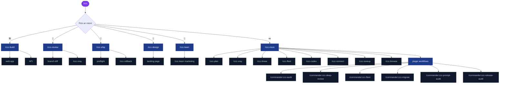

# Cheatsheet diagram template

Shape of the Mermaid map `/ccc-cheatsheet` renders. Every node below is an example: build the real nodes from the menu files and the workflows directory read in the same turn. A choice in a menu file becomes a node; a choice that is absent from the file is not drawn.

Mapping:

- `menus/ccc-root.json` `choices[]` → the intent nodes under `START`. Use each choice's `command` as the node label.
- `menus/ccc-<id>.json` `choices[]` → leaves under that intent. Label with `command` when it is a skill or skill-plus-argument, otherwise with `label`. Skip `back` choices.
- `workflows/*.workflow.js` → leaves under a `WF` node labelled `plugin workflows`, each `/commander:<name>`.
- Node ids are short and unique (`B1`, `R2`, `M5`, `W3`). Wrap labels that contain `/`, `:` or spaces in `["…"]` so Mermaid parses them.

````

````

Validity checks before rendering:

- Every node id used in a `class` line is defined above it.
- No label contains an unescaped `"` or `|`.
- One `graph TD` block; no HTML.
- Too many leaves to read (more than about 60 nodes): collapse each menu to its first four leaves plus a `+n more` node, where `n` is computed from the file.
