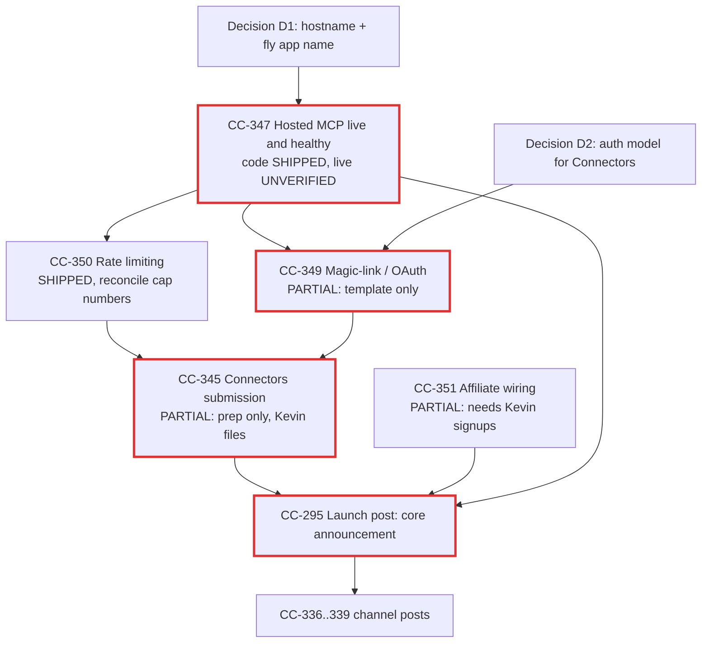

# CC-309 — v4.1 launch sequence: critical-path / dependency audit (slice 1)

- **Ticket:** CC-309 (Linear k3v80) "Plan v4.1 launch sequence (hosted MCP + Connectors + growth)"
- **Slice:** 1 of N, read-only audit. No launches, config changes, deploys or posts were made.
- **Audited at:** 2026-10-22, `origin/main` @ `e4f8492c`, repo version `8.1.0` (`package.json`).
- **Historical note:** v4.1 was planned right after v4.0.0 shipped (2026-04-26). The repo is now v8.1.0, so v4.1 is a historical label. This audit reports what exists today, not what was true in April. `docs/reference/claude-context-2026-09-05.md:75` still lists "v4.1 (next)" as hosted MCP + Commander Hub + Connectors submission, so that context file is stale on the label.

## Method and limits

- **Linear status: unverified for every ticket.** No Linear `get_issue` tool was available in this session. The ticket titles and scopes below come from the task brief only. Item status comes from repo evidence alone.
- Repo evidence shows code and docs exist. It does **not** show that anything is deployed, submitted or posted. Live checks (`/health`, Fly app state, Connectors dashboard, social accounts) were out of scope for a read-only slice and are listed as Kevin or follow-up verifications.
- `marketing/` is gitignored (`.gitignore:62`), so launch copy and the affiliate data file are local-only and cannot be audited from git history.

## Dependency table

Status key: SHIPPED = implemented in tree; PARTIAL = some pieces present; NOT STARTED = no evidence in tree; UNVERIFIED = depends on live state not checked.

| Item | Depends on | Status + evidence | Blocker |
|---|---|---|---|
| **CC-347** Hosted MCP deploy | Supabase project + schema, Upstash Redis, JWT secret, Fly app, domain | **SHIPPED in code, live state UNVERIFIED.** Server in `apps/mcp-server-cloud/` with `fly.toml:11` (`app = "commander-mcp"`), `Dockerfile`, `DEPLOY.md`, `/health` at `src/index.ts:80`, `/v1` mounted at `src/index.ts:388`. README claims "Shipping (hosted MCP)" at `mcp.commanderplugin.com` (`README.md:115`); site compare page cites `commander-mcp.fly.dev` (`site/app/compare/page.tsx:28`). Recent commits through `1efd9c0a` (8.1.0 prep) touch it. | Naming drift: `fly.toml` says `commander-mcp`, `DEPLOY.md:3` says `cc-commander-mcp`. Two hostnames in public copy. Deploy is Kevin-gated per `DEPLOY.md` ("one person's approval"). |
| **CC-349** OAuth magic-link | CC-347 (needs a deployed auth surface and an email sender); Supabase auth | **PARTIAL.** Email template exists: `apps/mcp-server-cloud/emails/magic-link.html:37,48` (`{{MAGIC_LINK_URL}}`). DB column anticipates it: `supabase/migrations/20260417000000_beta_v4.sql:13` ("set on magic-link signup"). **No route or code in `src/` issues or verifies a magic link**: grep for `magic`, `otp` and `/auth/` in `apps/mcp-server-cloud/src` returns nothing. Current auth is a Bearer JWT / license key (`src/middleware/auth.ts:22-34`). No OAuth authorization-server endpoints either. | No sending path, no verify callback, no OAuth 2.x flow. Connectors directory generally expects a standard OAuth or auth story, so this feeds CC-345. Email provider not chosen in tree. |
| **CC-350** Rate limiting | CC-347 (Redis) | **SHIPPED.** `src/middleware/ratelimit.ts:15-18` (Upstash sliding window 60/min, prefix `commander:burst`), monthly cap with `X-Commander-Calls-Used/Cap` headers (`:42-55`), 429 paths (`:59-87`), `mcp_quota_hit` PostHog event (`:74`). Wired after auth at `src/index.ts:186-189`. Separate in-memory events limiter 100 batches/hr/device: `src/routes/events.ts:20,111`, tested in `tests/events.test.ts:155`. | Fail-open on Redis outage (`ratelimit.ts:38`) and on DB error (`:135`) is deliberate, but needs a Kevin decision before public launch (see D3). The code's fail-open fallback cap is 1,000 calls/mo (`src/db/usage.ts:14`), while the site says 100 free calls/mo (`site/app/compare/page.tsx:28`) and the context doc says 100: **numbers disagree**. The README states no free-tier cap. Events limiter is per-process memory, so it is not shared across Fly machines. |
| **CC-351** Affiliate link wiring | None technical; partner signups (Kevin) | **PARTIAL.** Manager script exists: `scripts/affiliate-links.mjs` (commands `status/get/url/set/render/sync/revenue`, lines 9-20), added in `43268c79`. Its source of truth `marketing/affiliate-links.json` is **absent from the tree and gitignored** (`.gitignore:62`), so no partner IDs are wired into surfaces from this checkout. Nothing else in the repo references the script. | Needs Kevin's affiliate signups and partner IDs, then `sync`. FTC disclosure line must ship with links (the `/ccc-build` skill already carries one). |
| **CC-345** Anthropic Connectors directory submission | CC-347 live and stable; CC-349 (auth story); CC-350 (documented limits); privacy/ToS pages | **PARTIAL (prep only).** `CHANGELOG.md:882`: "MCP tool descriptions rewritten for Anthropic Connectors directory submission". Tool annotations added (`113b5154` CC-655, `fe0cf6a1`, `1efd9c0a` "annotated discovery"). `/.well-known/openai-apps-challenge` at `src/index.ts:97` (an OpenAI Apps route, which shows a sibling directory effort). **No evidence the submission was filed.** | Submission is a Kevin-only action (account, form, review). Depends on live HTTPS endpoint plus auth. |
| **CC-295** Public launch post (general) | CC-347 live; ideally CC-345 outcome | **UNVERIFIED / local-only.** Only `marketing/CONTENT/launch/codex-launch/` exists (blog, HN, marketplace, reddit, tweet files, gitignored). That folder targets the Codex port, not v4.1 hosted MCP. | Copy is stale relative to v8.x. Posting is Kevin-only. |
| **CC-336, CC-337, CC-338, CC-339** Launch posts (channels not stated in the brief) | CC-295 messaging, CC-347 live, demo assets | **UNVERIFIED, individual scopes unknown.** Likely map to the channels in `codex-launch/` (HN, Reddit, X thread, blog), plus video assets in `marketing/CONTENT/video/` (script, storyboard, recording checklist, YouTube metadata). Not confirmable without the Linear tickets. | Need ticket-to-channel mapping from Linear. Posts are Kevin-only. |

### Shipped / partial / not started, at a glance

- **Shipped (code):** CC-350 rate limiting; CC-347 server code and deploy docs.
- **Partial:** CC-349 (template and column only), CC-351 (tool only, no data), CC-345 (descriptions and annotations only).
- **Not started (in tree):** magic-link issue/verify routes and OAuth endpoints (CC-349 core); a filed Connectors submission (CC-345); v4.1-specific launch copy (CC-295, CC-336 to CC-339).
- **Unverified (live):** whether the Fly app is deployed and healthy; Linear ticket states.

## Critical-path graph

The critical path is **CC-347 (live and stable) → CC-349 (auth) → CC-345 (submission) → launch posts**. CC-350 and CC-351 are off-path but gate launch quality.

## Phases

**Phase 0: Reconcile (no code risk, 1 slice)**
- Pull live state: Linear status for all 9 tickets, `/health` on the production host, Fly app list.
- Fix naming and number drift (`commander-mcp` vs `cc-commander-mcp`; 100 vs 1,000 calls/mo; `mcp.commanderplugin.com` vs `commander-mcp.fly.dev`).
- Retire the "v4.1 (next)" wording in `docs/reference/claude-context-2026-09-05.md:75`.

**Phase 1: Platform ready (critical path)**
- CC-347: confirm or perform deploy (Kevin approval), smoke test with `apps/mcp-server-cloud/scripts/smoke-test.sh` against the real host.
- CC-350: decide fail-open policy (D3) and publish one canonical cap number.
- CC-349: implement magic-link issue and verify routes plus the OAuth surface the directory needs; pick an email provider.

**Phase 2: Distribution gate**
- CC-345: assemble submission pack (tool descriptions already done, plus auth docs, privacy/ToS URLs, rate-limit docs), Kevin submits.
- CC-351 in parallel: Kevin supplies partner IDs, run `affiliate-links.mjs render` then `sync`, review diff before merge.

**Phase 3: Public launch**
- CC-295 core announcement after Phase 1 is verified live. Refresh `marketing/CONTENT/launch/` copy to v8.x facts (the existing copy targets the Codex port).
- CC-336 to CC-339 staggered across channels after CC-295, ideally after the Connectors outcome is known, but not blocked on it.

## Kevin action items

Decisions are multiple choice. 🟢 marks the recommendation.

**D1. Canonical hostname and Fly app name**
- A) 🟢 `mcp.commanderplugin.com` as the public host, Fly app `commander-mcp` (matches `fly.toml:11`); update `DEPLOY.md` and the site compare page.
- B) Keep `commander-mcp.fly.dev` public, treat the custom domain as later.
- C) Rename the Fly app to `cc-commander-mcp` to match `DEPLOY.md`.
- Why A: a stable custom domain is what a directory listing and docs should point at; it avoids renaming a live app.

**D2. Auth model for the Connectors submission (CC-349 scope)**
- A) 🟢 Full OAuth 2.x authorization-code flow with magic-link as the login step.
- B) Magic-link issuing the existing Bearer JWT/license key only (smaller, may not satisfy the directory).
- C) Keep license keys only and submit without OAuth (fastest, highest rejection risk).
- Why A: it is the only option designed to pass directory review; confirm the directory's current auth requirement before building.

**D3. Rate-limit failure policy (CC-350)**
- A) 🟢 Keep fail-open on Redis/DB errors, add an alert on `mcp_quota_hit` plus Redis error rate.
- B) Fail-closed (safer against abuse, but an outage blocks all users).
- C) Fail-open with a coarse in-memory fallback limiter per machine.
- Why A: the free tier cost exposure is low and the code already documents the choice.

**D4. Free-tier monthly cap to publish**
- A) 🟢 100 calls/mo (matches site and context doc), set the code and README to match.
- B) 1,000 calls/mo (matches the code fallback in `src/db/usage.ts:14`).
- C) Tiered by survey answers as the README describes, published as "100 base".
- Why A: the 100 figure already appears in public-facing copy; note the code's fail-open fallback is 1000 (`apps/mcp-server-cloud/src/db/usage.ts:14`) and the real cap lives in the `get_effective_cap` DB function (`usage.ts:9`, schema not in the public tree), so verify the live value before choosing.

**D5. Launch ordering**
- A) 🟢 Soft launch (CC-295) once CC-347 and CC-349 are verified, do not wait for Connectors review, then channel posts CC-336 to CC-339 over about a week.
- B) Wait for the Connectors listing before any post.
- C) Launch everything in one day.
- Why A: directory review time is outside our control; staggering lets us fix issues between channels.

**Other Kevin-only actions (no decision needed)**
1. Approve and run the first production deploy if Phase 0 shows it is not live (`DEPLOY.md`).
2. Provide affiliate partner IDs for CC-351.
3. File the Connectors directory submission (CC-345) from the submission pack.
4. Publish all posts (CC-295, CC-336 to CC-339); no agent posts on your behalf.
5. Share the Linear ticket-to-channel mapping for CC-336 to CC-339, or grant a Linear tool to the next slice.

## Suggested next slices

1. Phase 0 reconcile (live checks, drift fixes) as a doc and copy PR.
2. CC-349 implementation with tests, once D2 is answered.
3. Submission pack for CC-345 once D1 and D2 are settled.
